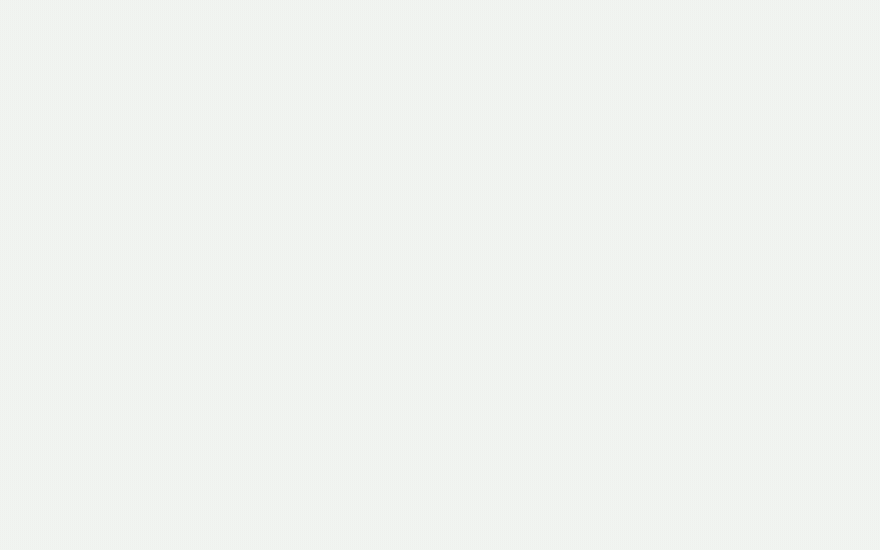
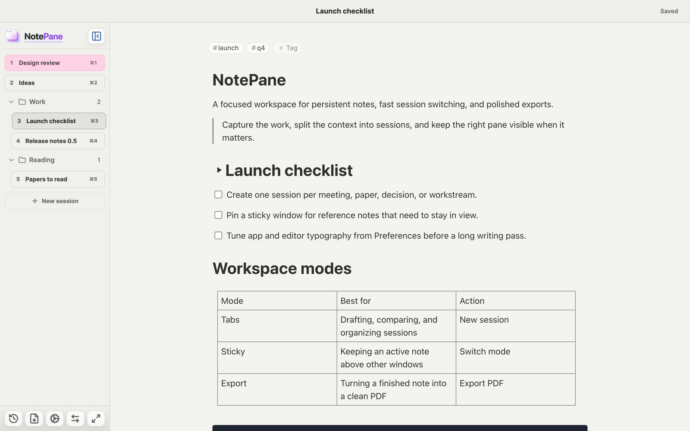
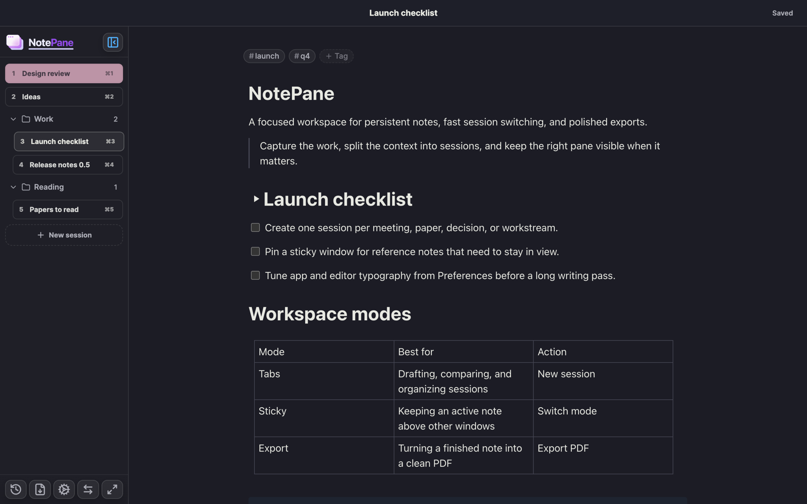
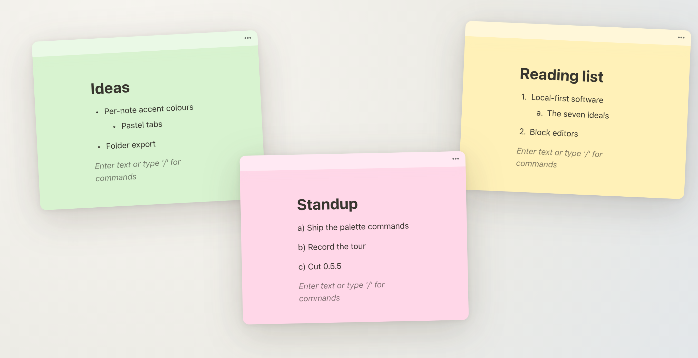
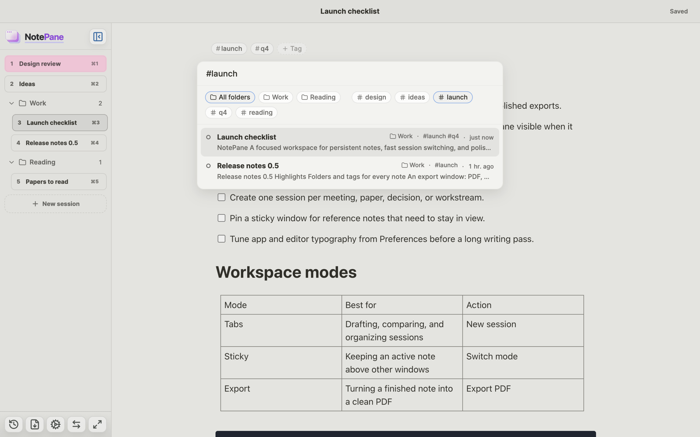
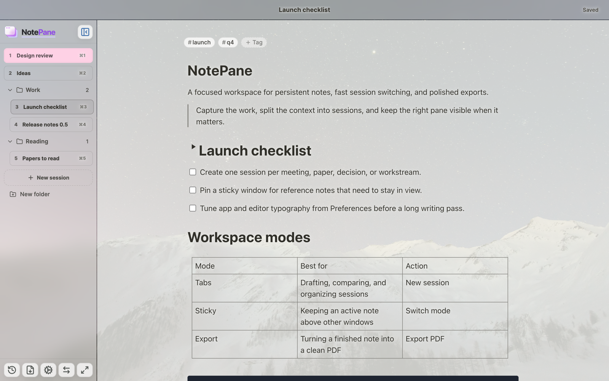
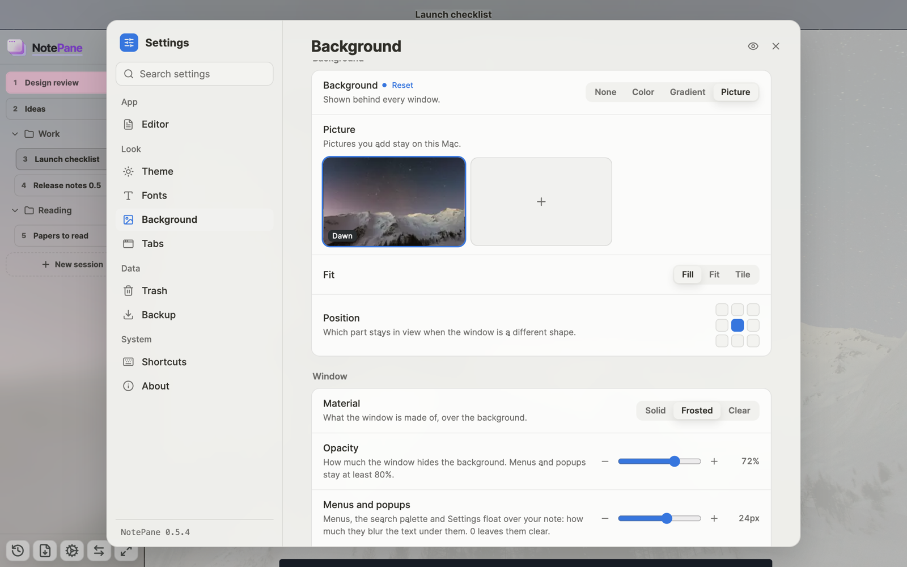
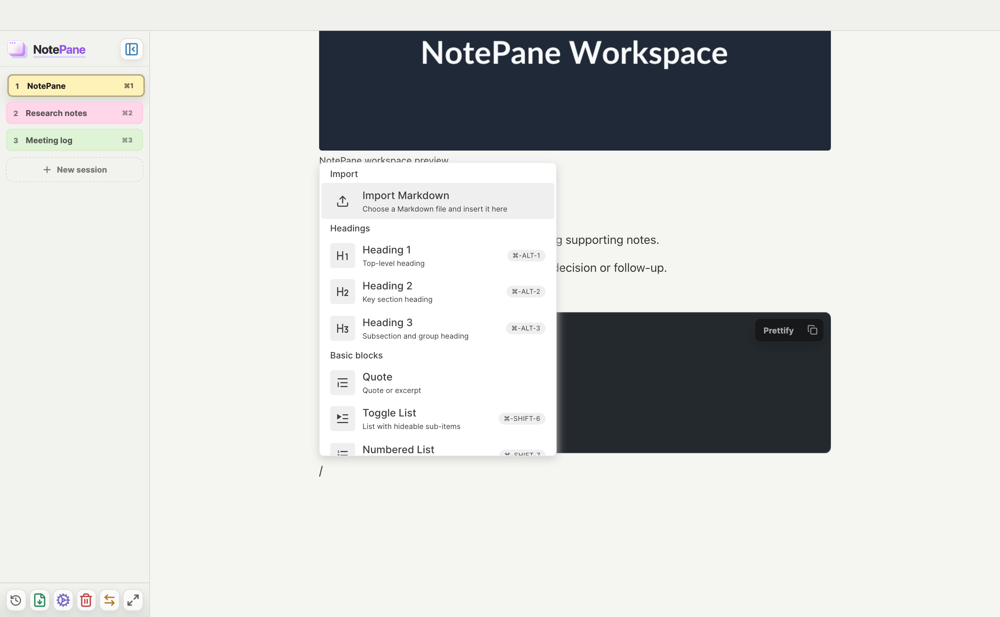

<div align="center">


# NotePane

**A block-based desktop note app that can spread out.**

Write in a Notion-style block editor, keep every note in one tidy window,
then scatter them across your desktop as pastel sticky windows when you need
them in view. Local-first, no account, no sync service.

macOS · Windows · built with [Electron](https://www.electronjs.org/) and [BlockNote](https://www.blocknotejs.org/)

[](https://github.com/Extransload/NotePane/releases/latest) [](LICENSE)

[Install](#install) · [Features](#features) · [Two modes](#two-modes) · [Everyday use](#everyday-use) · [Usage guide](docs/usage.md)



<sub>The same tour as a video: <a href="docs/media/tour.mp4">tour.mp4</a></sub>

</div>

---

## Why NotePane

Most note apps make you choose. Either everything lives in one window and
disappears the moment you switch away, or every note is a floating scrap with
no structure and no real editor.

NotePane does both, and switches between them with one shortcut.

- **A real block editor.** BlockNote gives you the `/` command palette,
  drag handles, nesting, tables, toggles and code blocks, used as-is rather
  than wrapped in a custom toolbar, so it behaves the way you already expect.
- **Two shapes for the same notes.** Gather them into a sidebar, or spread
  them across the screen. Nothing is duplicated or exported between modes.
- **Yours, on your disk.** Notes are a plain JSON file in your user data
  directory. No sign-in, no server, no telemetry.

---

## Features

**Write**
- **Blocks for everything.** Headings, lists, checklists, toggles, callouts, tables with column handles, columns,
  code blocks with highlighting and a prettifier, equations, bookmarks, images, files, video and audio.
- **A caret that glides.** The cursor moves smoothly as you type, in the theme's accent, and steps aside for Korean
  and other IME input.
- **Media you can act on.** Right-click an image, file or video to open it, preview it large, save, copy or crop it.

**Organise**
- **Folders and tags.** Group tabs into folders you collapse, rename and drop tabs onto, and tag notes from the
  chips above their first line.
- **Search and commands.** `⌘P` searches every note, filtered by `#tag` and `folder:Name` with one-click chips,
  and runs commands: a new folder, a theme, a Settings page, export and more. Type `>` for commands only.
- **Version history and Trash.** Every save keeps a version to go back to; a closed note waits in Trash.

**Export**
- One click for a PDF or Markdown copy of the open note, or the Export window for **PDF, Markdown, HTML or a PNG
  image** of a note, a folder or every note, with page size, colours, images beside the file and front matter.

**Make it yours**
- **51 themes**, from NotePane Light and Dark, Catppuccin, Nord, Dracula and Tokyo Night to Gruvbox, Rosé Pine and
  Neon Noir. Click a card and every window takes it at once.
- **A background behind the app.** A photo, a colour or a gradient, with the window made Solid, Frosted or Clear
  glass over it, and text kept readable.
- **Typography and tabs.** Editor and heading fonts, size, line height, text width; tab style, height and colours.
- **A settings window like Tern's.** One floating window with search across every setting, and an eye button to
  peek at the app behind it.

**Stays current.** On a Mac, a new release downloads by itself and **Restart to update** swaps it in. On Windows it
installs when you quit.

---

## Two modes

### Tab sessions mode

One window. Sessions live in the sidebar, in folders if you like, each with a `⌘1`–`⌘9` shortcut. Tabs stay
plain until you give one a colour. This is where you draft, compare and organise.

<div align="center">
  
</div>

<div align="center">
  
</div>

### Sticky windows mode

Every session becomes its own small window, arranged across your display and
tinted with its colour. Pin the ones you want above other apps and keep
working elsewhere.

<div align="center">
  
</div>

Press `⌘⇧T` to move between them.

---

## Find, theme, and set it up

<div align="center">
  
</div>

`⌘P` opens the search palette. Type words, `#tag` or `folder:Name`, or press the chips; matching commands show
above the notes, and `>` lists only commands.

<div align="center">
  
</div>

Settings › Look › Background puts a picture, colour or gradient behind the app and sets the glass over it.

<div align="center">
  
</div>

---

## The editor

<div align="center">
  
</div>

Type `/` anywhere to insert a block:

| | |
| --- | --- |
| **Text** | Paragraph, Heading 1–3, Toggle Heading, Quote, Callout, Divider |
| **Lists** | Bullet, Numbered, Check, Toggle |
| **Structure** | Table with advanced handles, Columns, Code block with syntax highlighting and a prettifier, Equation |
| **Media** | Image with crop, File, Video, Audio, Bookmark card |

Plus inline styles, links, a table of contents rail, find in note (`⌘F`), and Markdown import straight from the
slash menu.

---

## Install

### Homebrew (macOS, Apple silicon)

```sh
brew install --cask extransload/tap/notepane
```

The cask clears the download quarantine, so NotePane opens without the **Open Anyway** step. After that the app
updates itself; `brew upgrade --cask --greedy notepane` also works.

### Download

Get the latest version from
[Releases](https://github.com/Extransload/NotePane/releases/latest):

- **macOS (Apple silicon):** `NotePane-<version>-arm64.dmg`. Open it and drag
  NotePane to Applications. Intel Macs are not supported.
- **Windows:** `NotePane-Setup-<version>.exe`.

Until releases are code-signed, both systems ask once before the first launch.
On macOS, open NotePane from System Settings → Privacy & Security →
**Open Anyway**; the installer window walks you through it. On Windows,
choose **More info → Run anyway**.

### Updates

NotePane checks Releases at startup and every six hours; no note data is sent. On macOS a newer release downloads
in the background, its checksum and version are checked, and **Restart to update** appears in the window's title
bar: it saves your notes, swaps the new app in and opens it. On Windows the update installs when you quit.
Versions before 0.5.1 only link to the release page, so they need one update by hand.

### Build a package yourself

```bash
git clone https://github.com/Extransload/NotePane.git
cd NotePane
make install
make app
```

The installer lands in `release/`. `make app` builds for the machine you are
on; `make app-mac` produces macOS dmg and zip packages for Apple silicon, and
`make app-win` a Windows x64 installer.

### Run from source

```bash
make install
make run
```

`make run` builds the renderer and opens the desktop app. On WSL it produces a
Windows app folder and launches `NotePane.exe` for you.

**Requirements:** Node `^20.19` or `>=22.12`, and npm. `make install` also
downloads the Chromium build used by the test suite. Without `make`, the
equivalent is `npm install && npm run install:browsers && npm start`.

### Develop

```bash
make dev-web    # Vite dev server on 127.0.0.1:5173
make dev-app    # Electron against that server, in a second terminal
```

---

## Everyday use

Create a session, write, and switch. Sessions are titled automatically from
their first line until you rename one by double-clicking its tab.

| Shortcut | Action |
| --- | --- |
| `⌘T` / `⌘N` | New session |
| `⌘1` … `⌘9` | Jump to a session |
| `⌘P` | Search notes and run commands (`>` for commands only) |
| `⌘F` | Find in the open note |
| `⌘⇧T` | Switch between Tab sessions mode and Sticky windows mode |
| `/` | Open the block palette |
| `⌘,` | Settings |
| `⌘⇧E` | Export menu: PDF, Markdown, or Options… for the Export window |
| `⌘=` / `⌘-` / `⌘0` | Zoom every window |

These are the default macOS shortcuts (`⌘` = Command, `⇧` = Shift).
On Windows, use Ctrl instead of Command. Every shortcut can be changed in Settings › Shortcuts.
See the [usage guide](docs/usage.md) for more.

---

## Where your notes live

A single JSON file in Electron's `userData` directory:

```text
macOS     ~/Library/Application Support/NotePane/notes.json
Windows   %APPDATA%\NotePane\notes.json
```

It holds the BlockNote document, a Markdown fallback, folders, tags, window bounds, colours and typography for
every note; images and files you add sit beside it in `assets/`. Settings › Backup exports and imports everything,
so moving to another machine is a file copy.

---

## Contributing

```bash
npm run check:refs   # undefined references, about a second
npm run verify:quick # build, unit tests, distribution checks
npm run verify       # everything above plus both end-to-end suites
```

`docs/architecture.md` has a code map naming the file that owns each kind of
behaviour, and `AGENTS.md` describes how much verification a change needs.
Renderer code is grouped by ownership:

```text
src/editor/   editor engine and behaviour
src/model/    stored data and its normalisation
src/style/    colour maths and computed styles
src/ui/       React components
src/hooks/    stateful behaviour lifted out of the editor shell
src/utils/    small shared helpers
```

Tests live in `tests/e2e/renderer/` by feature, `tests/e2e/electron.spec.mjs`
for desktop behaviour, and `tests/unit/` for the store.

The README's screenshots and tour come from the built app with demo notes, never your own:

```bash
npm run build
node scripts/capture-readme-media.mjs            # every scene
node scripts/capture-readme-media.mjs tour desk  # just these
```

---

## Not included

AI, comments, real-time collaboration, sync between machines and DOCX/ODT export are not currently provided.
NotePane focuses on local note-taking.

---

## License

NotePane is licensed under the [MIT License](LICENSE).
Third-party dependencies remain subject to their respective licenses.
